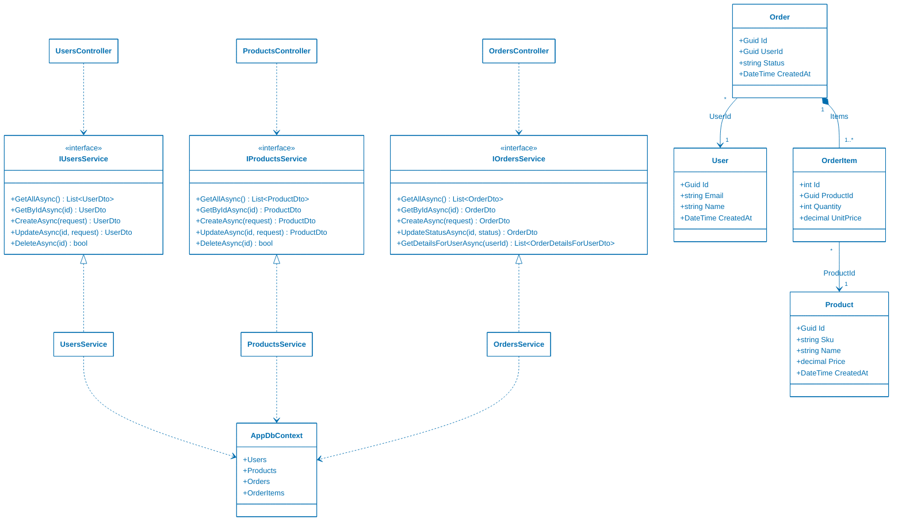

<!-- markdownlint-disable-next-line MD033 MD041 -->


# Universidad Católica del Uruguay

## Análisis y diseño de aplicaciones II

# Demo de monolito en capas

Esta aplicación es una API REST de una tienda sencilla, con usuarios, productos
y órdenes, hecha en .NET 10, ASP.NET Core y Entity Framework Core sobre SQLite.

Entity Framework Core -EF Core- es un ORM: la aplicación trabaja con objetos C#
y EF Core los traduce a tablas y consultas SQL, así que el código no escribe
SQL.

No tiene cliente web. Se prueba con Swagger UI en `/swagger` -solo en el entorno
`Development`- o con las requests de
[Ucu.Andis.Monolith.Web.http](Monolith.Web/Ucu.Andis.Monolith.Web.http).

Al arrancar, la aplicación aplica las migraciones pendientes. Una migración es
una clase C# generada por EF Core que describe un cambio en el esquema de la
base, como crear una tabla o agregar una columna. Al aplicarlas, las tablas
quedan de acuerdo con las entidades. Si la base está vacía, carga datos de
ejemplo con IDs fijos; por ejemplo, Alice es
`11111111-1111-1111-1111-111111111111`. Los datos están en
[DbInitializer.cs](Monolith.Infrastructure/DbInitializer.cs).

## Endpoints

| Recurso | Operaciones |
| --- | --- |
| `api/users` | `GET`, `GET {id}`, `POST`, `PUT {id}`, `DELETE {id}` |
| `api/products` | `GET`, `GET {id}`, `POST`, `PUT {id}`, `DELETE {id}` |
| `api/orders` | `GET`, `GET {id}`, `POST`, `PUT {id}/status` |
| `api/orders/user/{userId}/details` | `GET`: detalle de órdenes del usuario |

## Arquitectura

La solución sigue el [estilo de arquitectura en
capas](https://github.com/ucudal/ANDIS_Conceptos/blob/main/2_Tecnicas_y_herramientas/2_07_.Estilos_arquitectura/2_07_01_Layered_Architecture.md)
y se despliega como una sola unidad: un monolito.

| Proyecto | Capa | Responsabilidad |
| --- | --- | --- |
| [Monolith.Web](Monolith.Web/) | Presentación | Controllers HTTP, configuración y arranque |
| [Monolith.Application](Monolith.Application/) | Negocio | Servicios de aplicación y DTO |
| [Monolith.Infrastructure](Monolith.Infrastructure/) | Persistencia | Acceso a la base con `AppDbContext`, migraciones y datos de ejemplo |
| [Monolith.Domain](Monolith.Domain/) | Dominio | Entidades `User`, `Product`, `Order` y `OrderItem` |

Algunas observaciones:

- Los controllers exponen recursos
  [REST](https://github.com/ucudal/ANDIS_Conceptos/blob/main/4_Conceptos/4_REST.md)
  e intercambian DTO, siguiendo el patrón
  [MVC](https://github.com/ucudal/ANDIS_Conceptos/blob/main/2_Tecnicas_y_herramientas/2_09_.Patrones_de_arquitectura/2_09_MVC.md)
  sin vistas.
- La lógica está en
  [servicios](https://github.com/ucudal/ANDIS_Conceptos/blob/main/2_Tecnicas_y_herramientas/2_08_.Patrones_de_diseno/2_08_Service.md)
  que operan sobre
  [entidades](https://github.com/ucudal/ANDIS_Conceptos/blob/main/2_Tecnicas_y_herramientas/2_08_.Patrones_de_diseno/2_08_Entity.md).
  `Order` y sus `OrderItem` forman un
  [agregado](https://github.com/ucudal/ANDIS_Conceptos/blob/main/2_Tecnicas_y_herramientas/2_08_.Patrones_de_diseno/2_08_Aggregate.md):
  los ítems se crean y se borran con la orden.
- `Monolith.Application` depende de `Monolith.Infrastructure` y usa
  `AppDbContext` directamente, sin
  [repositorios](https://github.com/ucudal/ANDIS_Conceptos/blob/main/2_Tecnicas_y_herramientas/2_08_.Patrones_de_diseno/2_08_Repository.md).
  `AppDbContext` es la clase de EF Core que representa la base: tiene una
  colección por tabla -`Users`, `Products`, `Orders` y `OrderItems`- para
  consultar y guardar entidades. La dependencia apunta hacia la persistencia,
  al revés de lo que propone [Clean
  Architecture](https://github.com/ucudal/ANDIS_Conceptos/blob/main/2_Tecnicas_y_herramientas/2_07_.Estilos_arquitectura/2_07_09_Clean_Architecture.md).
- `OrdersService` lee directamente los usuarios y productos para armar los
  detalles de las órdenes. Ese
  [acoplamiento](https://github.com/ucudal/ANDIS_Conceptos/blob/main/4_Conceptos/4_Acoplamiento.md)
  entre órdenes, usuarios y productos es lo primero a resolver si se fuera a
  descomponer el monolito en
  [microservicios](https://github.com/ucudal/ANDIS_Conceptos/blob/main/2_Tecnicas_y_herramientas/2_07_.Estilos_arquitectura/2_07_08_Microservice_Architecture.md).

### Diagrama de clases

Diagrama de clases
[UML](https://github.com/ucudal/ANDIS_Conceptos/blob/main/2_Tecnicas_y_herramientas/2_03_.Modelos_de_estructura/2_03_01_Diagramas_de_clases_UML.md)
simplificado: omite los DTO y los métodos de los controllers.



Las asociaciones de `Order` con `User` y de `OrderItem` con `Product` se
implementan solo con el ID: `Order` guarda `UserId` y `OrderItem` guarda
`ProductId`. No hay una propiedad que referencie al objeto -como `order.User` o
`item.Product`-; en EF Core eso se llama *propiedad de navegación*. Para obtener
el usuario de una orden hay que buscarlo por su ID; así, las órdenes no dependen
de las clases `User` ni `Product`. En cambio, `Order.Items` y `OrderItem.Order`
sí son referencias entre objetos, porque la orden y sus ítems forman un
agregado.

## Ejecutar localmente

Requiere el SDK de .NET 10.

```sh
dotnet run --project Monolith.Web --launch-profile http
```

La API queda en `http://localhost:5101` y Swagger en
`http://localhost:5101/swagger`.

En VS Code, la configuración de depuración **Monolith.Web** compila, arranca la
aplicación y abre Swagger.

### Borrar la base de datos

La base SQLite está en `Monolith.Web/Data/` y puede ocupar hasta tres archivos:

| Archivo | Contenido |
| --- | --- |
| `andisdemo.db` | La base de datos |
| `andisdemo.db-wal` | Cambios recientes aún no pasados a `andisdemo.db` |
| `andisdemo.db-shm` | Índice compartido del archivo `-wal` |

Los archivos `-wal` y `-shm` son temporales: SQLite los borra cuando la
aplicación se detiene normalmente, pero quedan si el proceso termina de golpe;
por ejemplo, al matarlo o al cerrar el contenedor que lo ejecuta.

Para borrar la base con `dotnet ef` se necesita `dotnet-ef`, la herramienta de
línea de comandos de EF Core, que no viene con el SDK. Debe ser de la versión 10
o posterior, la misma versión principal de EF Core que usa el proyecto:

```sh
dotnet tool install --global dotnet-ef   # si no está instalada
dotnet tool update --global dotnet-ef    # si ya está instalada
dotnet ef --version
```

Para empezar con una base nueva:

1. Detener la aplicación, sea local, en el Dev Container o en una sesión de
   depuración.
2. Borrar la base con la tarea `ef: database drop` de VS Code -*Tasks: Run
   Task*- o con este comando, desde la raíz del repositorio:

   ```sh
   dotnet ef database drop --force \
     --project Monolith.Infrastructure --startup-project Monolith.Web
   ```

   `--project` indica el proyecto que tiene `AppDbContext` y `--startup-project`
   el que tiene la configuración, como la ubicación de la base.
3. Borrar los archivos temporales, si quedaron, porque `database drop` no los
   borra:

   ```sh
   rm -f Monolith.Web/Data/andisdemo.db-wal \
     Monolith.Web/Data/andisdemo.db-shm
   ```

También se pueden borrar los tres archivos directamente, sin `dotnet-ef`:

```sh
rm -f Monolith.Web/Data/andisdemo.db*
```

Al arrancar, la aplicación vuelve a crear la base con las migraciones y carga
los datos de ejemplo. La base del contenedor Docker es otra, porque está en un
volumen; se borra con `docker compose down -v`.

## Ejecutar en Docker

La aplicación se empaqueta en un
[contenedor](https://github.com/ucudal/ANDIS_Conceptos/blob/main/4_Conceptos/4_Contenedores.md),
lo que mejora la [facilidad de
despliegue](https://github.com/ucudal/ANDIS_Conceptos/blob/main/4_Conceptos/4_Facilidad_de_despliegue.md):
no hace falta instalar .NET en el anfitrión.

```sh
docker compose up --build
```

La API queda en `http://localhost:8080`; por ejemplo,
`http://localhost:8080/api/products`. El contenedor corre en el entorno
`Production`, así que no expone Swagger.

La base SQLite vive en el volumen `andis-data`, montado en `/app/Data`, y se
conserva aunque se borre el contenedor. Para empezar con una base nueva:

```sh
docker compose down -v
```

## Desarrollar en un Dev Container

El repositorio incluye un [Dev Container](.devcontainer/devcontainer.json): VS
Code se abre dentro de un contenedor con el SDK de .NET 10, la extensión C# Dev
Kit y `dotnet-ef` ya instalados. Solo requiere Docker y la extensión Dev
Containers.

1. En VS Code, ejecutar **Dev Containers: Reopen in Container** desde la paleta
   de comandos (`⇧⌘P` o `Ctrl+Shift+P`). La primera vez tarda unos minutos
   porque descarga la imagen e instala las herramientas.
2. Depurar con la configuración **Monolith.Web**, igual que en local: los
   breakpoints funcionan sin configuración adicional, porque el depurador corre
   dentro del mismo contenedor que la aplicación.
3. VS Code reenvía el puerto 5101, así que la API y Swagger quedan en
   `http://localhost:5101`, y el archivo `.http` funciona sin cambios.

La tarea `ef: database drop` también funciona dentro del contenedor. El
repositorio se monta en el contenedor, así que la base
`Monolith.Web/Data/andisdemo.db` es la misma que fuera de él.

Para volver a trabajar en local, ejecutar **Dev Containers: Reopen Folder
Locally**.

Las carpetas `bin/` y `obj/` también se comparten, y el restore de cada
entorno deja en `obj/` rutas que solo valen para ese entorno. Al pasar del Dev
Container a local, o al revés, ejecutar `dotnet restore` antes de compilar o de
usar `dotnet ef`; si no, aparecen errores como `Unable to retrieve project
metadata`.
